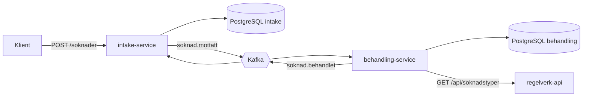

# Søknadsflyt

En liten, hendelsesdrevet integrasjon mellom to Kotlin/Spring Boot-tjenester. En søknad
mottas via REST, behandles asynkront via Kafka, og status flyter tilbake til
mottakstjenesten.

## Arkitektur



1. `intake-service` tar imot en søknad (REST), validerer og lagrer den, og publiserer
   `SoknadMottatt` på Kafka.
2. `behandling-service` lytter på hendelsen, henter regler for søknadstypen fra et
   eksternt REST-API, ferdigstiller behandlingen og publiserer `SoknadBehandlet`.
3. `intake-service` lytter på `SoknadBehandlet` og setter søknaden til `FERDIG`.

Det eksterne regelverk-API-et simuleres med WireMock.

## Teknologi

Kotlin, Spring Boot 4, Spring Data JPA, Spring for Apache Kafka, PostgreSQL, Flyway,
Docker Compose, Testcontainers, GitHub Actions.

## Kjør lokalt

Krever Docker og JDK 21.

```bash
docker compose up -d
cd intake-service && ./gradlew bootRun        # port 8080
cd behandling-service && ./gradlew bootRun    # port 8081
```

Send en søknad og følg den:

```bash
curl -X POST localhost:8080/soknader -H 'Content-Type: application/json' \
  -d '{"sokerNavn":"Kari Nordmann","sokerEpost":"kari@example.com","type":"DAGPENGER"}'
curl localhost:8080/soknader/<id>
curl localhost:8081/behandlinger/<id>
```

## Tester

Integrasjonstestene bruker Testcontainers (ekte PostgreSQL og Kafka) og krever Docker:

```bash
cd intake-service && ./gradlew test
cd behandling-service && ./gradlew test
```

Testene dekker blant annet at en lagret søknad gir en hendelse på Kafka, at validering
avviser ugyldige søknader, og at samme melding levert to ganger ikke gir dobbel behandling.
## Kjør i Kubernetes (lokalt med kind)

Krever Docker, [kind](https://kind.sigs.k8s.io/) og kubectl.

```bash
kind create cluster --name soknadsflyt

docker build -t intake-service:local intake-service
docker build -t behandling-service:local behandling-service
kind load docker-image intake-service:local behandling-service:local --name soknadsflyt

kubectl apply -f k8s/00-namespace.yaml
kubectl create secret generic soknad-db --namespace soknadsflyt \
  --from-literal=username=soknad --from-literal=password=soknad
kubectl apply -f k8s/
kubectl get pods -n soknadsflyt -w
```

Når alle pods er `Running`, åpne port-forward og send en søknad:

```bash
kubectl port-forward -n soknadsflyt svc/intake-service 8095:8080
kubectl port-forward -n soknadsflyt svc/behandling-service 8096:8080
```

Manifestene ligger i `k8s/`: Deployments for tjenestene, StatefulSets for Postgres,
ConfigMaps for konfigurasjon, og liveness-/readiness-probes mot Spring Actuator.
Databasepassordet ligger i en Secret som opprettes manuelt og ikke sjekkes inn i repoet.

## Designvalg

- **Hver tjeneste har sin egen database.** Tjenestene deler ingen tabeller og er
  uavhengige av hverandre. Kontrakten mellom dem er JSON-meldingene.
- **Hendelsen publiseres etter commit.** Det hindrer at `SoknadMottatt` sendes for en
  søknad som aldri ble lagret.
- **Idempotent konsument.** Kafka leverer minst én gang, så `behandling-service` kan få
  samme melding flere ganger uten å behandle søknaden flere ganger.
- **Hver tjeneste oppretter topicene den bruker.**

## Kjente begrensninger og videre arbeid

- Hendelsen kan gå tapt hvis Kafka er nede akkurat når den skal publiseres. Løsningen er
  *transactional outbox*, som ikke er implementert.
- Ingen dead letter-topic eller kontrollert retry-strategi for meldinger som feiler.
- Kafka og Postgres kjører som enkle enkeltinstanser i klyngen, uten replikering eller backup.
- Passordet i eksemplene er et lokalt testpassord. Reelle hemmeligheter bør komme fra en secret manager.
- Ingen autentisering.