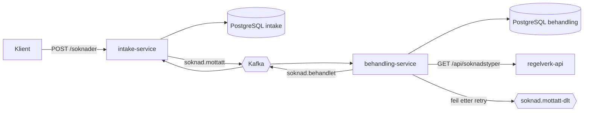

# Søknadsflyt


En liten, hendelsesdrevet integrasjon mellom to Kotlin/Spring Boot-tjenester. En søknad
mottas via REST, behandles asynkront via Kafka, og status flyter tilbake til
mottakstjenesten. Prosjektet kjører lokalt med Docker Compose og i Kubernetes (kind),
med Prometheus og Grafana for monitorering.

## Arkitektur



1. `intake-service` tar imot en søknad (REST), validerer og lagrer den, og publiserer
   `SoknadMottatt` på Kafka.
2. `behandling-service` lytter på hendelsen, henter regler for søknadstypen fra et
   eksternt REST-API, ferdigstiller behandlingen og publiserer `SoknadBehandlet`.
3. `intake-service` lytter på `SoknadBehandlet` og setter søknaden til `FERDIG`.
4. Hvis behandlingen feiler gjentatte ganger, havner meldingen på dead letter-topicet
   `soknad.mottatt-dlt`.

Det eksterne regelverk-API-et simuleres med WireMock.

## Teknologi

Kotlin, Spring Boot 4, Spring Data JPA, Spring for Apache Kafka, PostgreSQL, Flyway,
Micrometer, Docker, Docker Compose, Kubernetes (kind, Kustomize), Prometheus, Grafana,
Testcontainers, GitHub Actions, Bootstrap.

## Kjør lokalt med Docker Compose

Krever Docker og JDK 21.

```bash
docker compose up -d
cd intake-service && ./gradlew bootRun        # port 8080
cd behandling-service && ./gradlew bootRun    # port 8081
```

Compose starter to PostgreSQL-databaser (`intake-db` på port 5434 og `behandling-db` på
port 5433), Kafka (port 9092) og WireMock som regelverk-API (port 8089).

Send en søknad og følg den:

```bash
curl -X POST localhost:8080/soknader -H 'Content-Type: application/json' \
  -d '{"sokerNavn":"Kari Nordmann","sokerEpost":"kari@example.com","type":"DAGPENGER"}'
curl localhost:8080/soknader/<id>
curl localhost:8081/behandlinger/<id>
```

Søknaden går fra `MOTTATT` til `FERDIG` hos intake, og behandlingen står som `FERDIG`
hos behandling.

## Enkel nettside

`intake-service` serverer en liten nettside på `/` som lar deg sende søknader og følge med
mens de går fra `MOTTATT` til `FERDIG`. Den ligger i
`intake-service/src/main/resources/static/index.html`, er ren HTML og JavaScript uten
byggesteg, og bruker Bootstrap (CSS-filen ligger i repoet, så siden fungerer uten
internett). Lokalt åpner du `http://localhost:8080`, og i Kubernetes åpner du
port-forwarden (for eksempel `http://localhost:8095`).

## Kjør i Kubernetes (lokalt med kind)

Krever Docker, [kind](https://kind.sigs.k8s.io/) og kubectl.

```bash
kind create cluster --name soknadsflyt

docker build -t intake-service:local intake-service
docker build -t behandling-service:local behandling-service
kind load docker-image intake-service:local behandling-service:local --name soknadsflyt

kubectl apply -k k8s/overlays/local
kubectl get pods -n soknadsflyt -w
```

Når alle pods er `Running`, åpne port-forward i to terminalvinduer:

```bash
kubectl port-forward -n soknadsflyt svc/intake-service 8095:8080
kubectl port-forward -n soknadsflyt svc/behandling-service 8096:8080
```

Send så en søknad som over, men mot `localhost:8095` (intake) og `localhost:8096`
(behandling).

Manifestene bruker Kustomize:

- `k8s/base` inneholder det som er felles: Deployments for tjenestene, StatefulSets for
  Postgres, Kafka, mock-API, ConfigMaps og liveness-/readiness-probes mot Spring Actuator.
- `k8s/overlays/local` tilpasser det til en lokal kind-klynge: bildetagger og et lokalt
  testpassord som Kustomize genererer som en Secret.
- `k8s/overlays/scaled` kjører to replikaer av hver tjeneste
  (`kubectl apply -k k8s/overlays/scaled`). Siden `soknad.mottatt` har én partisjon, er det
  bare én replika av `behandling-service` som får meldinger. Resten venter som reserve.
- `k8s/overlays/monitoring` legger Prometheus og Grafana til (se under).

Fjern klyngen med `kind delete cluster --name soknadsflyt`.

## Monitorering (Prometheus og Grafana)

Begge tjenestene eksponerer metrikker på `/actuator/prometheus` (Micrometer). Egne
metrikker: `soknader_mottatt_total`, `soknader_ferdig_total`,
`behandlinger_ferdigstilt_total`, `behandling_forsok_feilet_total`,
`soknader_dead_letter_total` og en timer for kall mot regelverk-API-et
(`regelverk_kall_seconds_*`). I Kubernetes kan Prometheus og Grafana legges til med en
egen overlay:

```bash
kubectl apply -k k8s/overlays/monitoring
kubectl port-forward -n soknadsflyt svc/grafana 3000:3000
```

Åpne `http://localhost:3000` og dashboardet «Søknadsflyt». Dashboardet og datakilden
lastes inn automatisk fra filer i `k8s/monitoring/grafana/`.

## Tester

Integrasjonstestene bruker Testcontainers (ekte PostgreSQL og Kafka) og krever Docker:

```bash
cd intake-service && ./gradlew test
cd behandling-service && ./gradlew test
```

Testene dekker blant annet at en lagret søknad gir en hendelse på Kafka, at validering
avviser ugyldige søknader, at `SoknadBehandlet` setter søknaden til `FERDIG`, at
metrikkene eksponeres, at samme melding levert to ganger ikke gir dobbel behandling, og at
ugyldige meldinger og ukjente søknadstyper havner på dead letter-topicet.

GitHub Actions kjører bygg og tester for begge tjenestene på hver push og pull request.
Etterpå bygger arbeidsflyten Docker-bildene, starter en kind-klynge, deployer med
Kustomize og kjører `scripts/e2e-k8s.sh`. Skriptet sender en søknad gjennom hele flyten og
sjekker at den ender som `FERDIG` hos begge tjenestene. Det samme skriptet kan du kjøre
lokalt mot kind-klyngen din.

## Designvalg

- **Hver tjeneste har sin egen database.** Tjenestene deler ingen tabeller og er
  uavhengige av hverandre. Kontrakten mellom dem er JSON-meldingene, og hver tjeneste har
  sin egen kopi av hendelsesklassene i stedet for en felles modul.
- **Hendelsen publiseres etter commit.** Det hindrer at `SoknadMottatt` sendes for en
  søknad som aldri ble lagret.
- **Idempotent konsument.** Kafka leverer minst én gang, så `behandling-service` kan få
  samme melding flere ganger uten å behandle søknaden flere ganger.
- **Retry og dead letter-topic i `behandling-service`.** Feil mot regelverk-API-et
  forsøkes på nytt med økende ventetid (eksponentiell backoff). Etter fire forsøk havner
  meldingen på `soknad.mottatt-dlt` i stedet for å blokkere køen. Ødelagte meldinger og
  4xx-svar fra API-et (som ikke blir bedre av retry) går rett til dead letter-topicet.
- **Hver tjeneste oppretter topicene den bruker.** Da kan en consumer starte uten å
  vente på at en annen tjeneste har opprettet topicet.
- **Konfigurasjon via miljøvariabler.** Samme containerbilde brukes lokalt og i
  Kubernetes. Spring leser for eksempel `SPRING_DATASOURCE_URL` fra miljøet, og
  ConfigMaps og Secrets i Kubernetes setter verdiene.
- **Metrikker uten tagger fra brukerinput.** Tellerne har ingen tagger som kommer fra
  forespørslene (som søknadstype), siden det kan gi uendelig mange verdier i Prometheus.

## Kjente begrensninger og videre arbeid

- Hendelsen kan gå tapt hvis Kafka er nede akkurat når den skal publiseres. Løsningen er
  *transactional outbox*, som ikke er implementert.
- Retryene blokkerer konsumenten mens de pågår. For lengre ventetider bør man bruke egne
  retry-topics. Meldinger på dead letter-topicet kan ikke spilles av igjen automatisk.
- Kafka og Postgres kjører som enkle enkeltinstanser i klyngen, uten replikering eller backup.
- Passordet i eksemplene er et lokalt testpassord. Reelle hemmeligheter bør komme fra en
  secret manager.
- Ingen autentisering og ingen Ingress. Tjenestene nås med `port-forward`.
- Kafka-topicet `soknad.mottatt` har én partisjon, så behandlingen skalerer ikke
  horisontalt før partisjonstallet økes.
- Prometheus henter fra tjenestene via Service-navn, ikke via Kubernetes service discovery.
  Med flere replikaer havner derfor hvert hent på en tilfeldig pod. Prometheus lagrer data
  i et midlertidig volum, så historikken forsvinner når den starter om. Grafana kjører uten
  innlogging og er kun ment for lokal bruk.
- Ingen alarmer (Alertmanager).